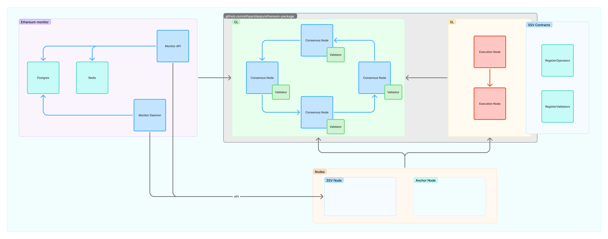

# SSV-Mini

Local SSV testnet in ~4 minutes. Kurtosis-based devnet for developing and testing SSV nodes.

## Prerequisites

- [Docker](https://docs.docker.com/get-docker/) (or [OrbStack](https://orbstack.dev/) on macOS)
- [Kurtosis CLI](https://docs.kurtosis.com/install) (`brew install kurtosis-tech/tap/kurtosis-cli`)

**Recommended:** 8+ CPU cores, 16GB+ RAM allocated to Docker.

## Quick Start

```bash
git clone https://github.com/ssvlabs/ssv-mini.git && cd ssv-mini
make prepare    # Clone SSV repo + build Docker image (~5 min first time)
make run        # Start the testnet (~4 min)
```

That's it. Run `make show` to see services and ports, `make logs` to tail SSV node logs.

### Test a specific SSV branch

```bash
SSV_COMMIT=my-feature-branch make prepare
make run
```

### Push code changes to a running testnet (~30s)

```bash
cd ../ssv && docker build -t node/ssv .
cd ../ssv-mini && make restart-ssv-nodes   # NOT mid-scenario — see the warning below
```

Or use the `ssv-mini` CLI tool from the SSV repo:

```bash
# Install (one time, from ssv-mini repo):
ln -sf "$(pwd)/scripts/ssv-mini" ~/bin/ssv-mini

# Then from the SSV repo:
ssv-mini              # Create testnet or push code to running one
ssv-mini restart      # Rebuild + restart SSV nodes only
ssv-mini logs         # Tail SSV node 0 logs
```

## All Commands

```
make help
```

| Command | Description |
|---------|-------------|
| `make run` | Start testnet (default: Fulu at genesis) |
| `make run-boole` | Start with Boole fork at epoch 3 |
| `make run-gloas` | Start with Gloas/ePBS (EIP-7732) fork at epoch 2 (devnet-6 images) |
| `make reset` | Clean + restart from genesis |
| `make show` | Show running services and ports |
| `make logs` | Tail ssv-node-0 logs (`SERVICE=ssv-node-1` for others) |
| `make clean` | Remove all enclaves |
| `make restart-ssv-nodes` | Restart SSV nodes (after rebuilding image). **Never mid-scenario:** it is a bare, unarchived `kurtosis service update` — it wipes the log buffer and drops any active `FAULT`. Use `make fault` / `make fault-off` instead. |
| `make prepare` | Clone SSV repo + build Docker image |
| `make prepare-anchor` | Clone Anchor repo + build Docker image; useful when using custom branch |
| `make prepare-monitor` | Clone E2M repo + build Docker image |
| `make prepare-all` | Build SSV + Anchor + Monitor images |
| `make generate-keys` | Regenerate static operator keys + keyshares |

### Fault Injection

| Command | Description |
|---------|-------------|
| `make stop-el` | Stop geth (simulate EL crash) |
| `make start-el` | Restart stopped geth |
| `make swap-el EL_IMAGE=` | Hot-swap geth to custom image |
| `make restore-el` | Restore default geth |
| `make test-faulty-el` | Bloom filter cross-check test |

Use `EL_SERVICE=el-2-geth-lighthouse` to target the second EL node.

### Switching an SSV node fault

**Prerequisite:** the enclave's SSV image must be a fault-injection build of the node —
`node/ssv-fault`, built from an ssv branch that carries the `qa/faults/` fault menu (a distinct tag
so `FAULT=none` operators can keep running the plain `node/ssv` image; see that branch's
`qa/FAULTS.md`) — and `$SSV_REPO` (default `../ssv`)
must be checked out on that same branch, because `make fault-list`/`make fault` enumerate the menu
by running `go run ./qa/faults/cmd/list` in it. On a stock node `FAULT` is simply ignored, so a
missed prerequisite does not error clearly — it shows up as the boot-banner timeout below.

```bash
make fault-list                          # the available values
make fault FAULT=vote-index-2 OP=5       # archive, switch, verify
make fault-off OP=5
```

`make fault` rejects a value that is not in the menu **before** it touches the enclave, and fails
fast if `OP`'s container cannot be resolved — in both cases nothing is archived and nothing is
switched. Container resolution is by Kurtosis label (`kurtosis_service_name` /
`kurtosis_enclave_uuid`), not by container name, so a co-tenant enclave running the same operator
index cannot be picked by accident; a match count other than 1 is always an error. Otherwise it
archives the operator's buffered logs to `.fault-logs/` first, because the switch destroys them,
and aborts if the archive holds no JSON log lines — pass `ALLOW_EMPTY_ARCHIVE=1` only when the
operator genuinely has no logs worth keeping (`fault-off` warns instead of aborting on this, since
it runs at the end of a fault window and aborting would strand the operator faulted). The switch
command's own exit status is checked — a failed `kurtosis service update` stops the recipe there,
it does not fall through to verification against the still-running old container. It then fails
non-zero unless the **newly-created** container comes back within `FAULT_BANNER_TIMEOUT` (default
180 s) with a boot banner naming the requested fault (the poll re-resolves the container by label
each iteration and skips while its ID still matches the pre-switch container, so a retried or
same-value switch cannot be verified against the old container's buffer); on that timeout, do not
trust results from this operator's window until its state is confirmed by hand — the most likely
cause is that the enclave is not running the instrumented image (see the prerequisite above; on a
stock node this timeout is exactly what you see). `make fault-off OP=5` runs the same
archive-then-verify sequence with `FAULT=none`.

To run one operator on a different MEV gas limit (the node's `ExperimentalGasLimit` / env
`EXPERIMENTAL_GAS_LIMIT`, `operator/validator/controller.go:99` in `ssv`), set the
`operator_gas_limits` params key before bring-up (see `params-gloas-fault.yaml`), or switch a
running operator with `make gas-limit OP=<n> VALUE=<gas>` (`VALUE=default` restores the node's
built-in default). `make gas-limit` archives and verifies the same way as `make fault`.

A fault switch is a `kurtosis service update`, which re-creates the container: the node's buffered
logs are lost and it resyncs before it takes part in duties again. Measured on a 4-node Gloas
enclave on 2026-09-08: **7 s** from the update to the boot banner, **1 slot** until the
operator injected its first fault. `make fault` archives the logs before switching for exactly this
reason. A `kurtosis service stop` + `start` **does** preserve the container filesystem.

### Reading ssv-node logs

`kurtosis service logs` could return nothing for `ssv-node` on this rig, and no query change fixed
it — **`docker logs <container>` is the always-available read path.** Three causes were found:

- Unconditional OTLP trace export to a collector no profile here creates — **fixed**, gated behind
  `nodes.ssv.enable_traces` (default off, see `params.yaml`). The node takes `--config=` from its
  entrypoint (`nodes/ssv/node.star`), not from the env-var list, so a fault switch cannot drop it.
- The container printing plain-text lines from the node's own Makefile target before its JSON
  logging started — **fixed**, by exec'ing the `ssvnode` binary directly instead of going through
  `make`.
- Kurtosis's own log-collection engine could not read the resulting per-line JSON — **fixed
  2026-09-09 in the developer's Kurtosis config**. The enclave-wide fluent-bit filter is *not* a
  Kurtosis default: it is declared in
  `~/Library/Application Support/kurtosis/kurtosis-config.yml`, under
  `kurtosis-clusters.docker.logs-collector.{parsers,filters}`.

  With a **json** parser it hoisted each line's fields to the record root *with native types*
  (`slot`:int, `count`:int, `validators`:list). Kurtosis's own per-week file store decodes stored
  lines into a string-valued map, so any non-string value broke it and `kurtosis service logs`
  returned nothing — with **exit code 0 and the error on stderr**, so callers that only read
  stdout reported "no logs found" instead of a failure.

  The cause was native types, not parsing. A **`format: regex`** parser emits only its named
  captures and **every capture is a string**, so it can still consume `time_key` — keeping the
  node's own microsecond-precision, correctly-ordered timestamps in Loki — while leaving the record
  all-string and readable. The config now uses parser `ssv_time_only`
  (`regex: '"time":"(?<time>[^"]+)"'`) plus **`Preserve_Key: On`** on the filter, which is required
  to keep the `log` string so the reader still has a message. Verified on fluent-bit 4.0.0 against
  a real ssv-node line. Structured fields are recovered at query time in Grafana with
  `{job="kurtosis"} | json | line_format "{{.log}}" | json`.

  The collector is created **per enclave**, so this only takes effect on a fresh enclave. Until it
  is confirmed there (`kurtosis service logs <enclave> ssv-node-0 -n 5` returning lines), treat
  `docker logs` as the reliable read path and grep its output, e.g.:

```bash
# Scope to THIS enclave — a co-tenant enclave can run its own ssv-node-5, and reading the wrong
# one silently shows healthy logs for a node you are not testing.
ENCLAVE_UUID=$(kurtosis enclave inspect localnet --full-uuids | awk '/^UUID:/{print $2}')
docker logs $(docker ps --filter label=kurtosis_service_name=ssv-node-5 \
                        --filter label=kurtosis_enclave_uuid=$ENCLAVE_UUID \
                        --format '{{.Names}}') | grep '"qa_fault"'
```

`make logs SERVICE=ssv-node-5` and `./scripts/ssv-mini logs 5` already do this lookup for you.

## Configuration

Edit `params.yaml` to customize the network:

```yaml
nodes:
  ssv:
    count: 4      # Valid: 4, 7, 10, 13 (3f+1 for BFT)
  anchor:
    count: 0      # Anchor consensus client nodes

images:
  ssv: "node/ssv"
  anchor: "sigp/anchor:v1.2.0"  # needs to be changed to node/anchor when using local built anchor image

network:
  network_params:
    fulu_fork_epoch: 0  # 0 = active at genesis (default); set large (e.g. 100000) to defer

boole_epoch: 3          # Omit for pre-Boole

use_static_keys: true   # false = regenerate keys at runtime (~40s slower)
```

Pre-built configs:
- `params.yaml` — Fulu at genesis (default)
- `params-boole.yaml` — Alan→Boole fork transitions; needs `SSV_COMMIT=integration/boole-convergence make prepare`
- `params-gloas.yaml` — Fulu→Gloas (ePBS/EIP-7732) transition; needs `SSV_COMMIT=stage make prepare` and ethpandaops glamsterdam-devnet-6 client images (digest-pinned; monitor/E2M enabled - prepare it beforehand)
- `params-gloas-multibn.yaml` — same Gloas transition, but each operator gets its own beacon/execution node pair instead of sharing one (see `operator_pairs` below); needs the same `SSV_COMMIT=stage make prepare`
- `params-gloas-builder.yaml` — same Gloas transition plus an external ePBS builder (buildoor) and the SSV `Builders` overlay; `make run-gloas-builder`. See "Gloas builder rig (buildoor)" below

```bash
make run PARAMS_FILE=params-boole.yaml
```

### Per-operator beacon and execution nodes (`operator_pairs`)

By default every SSV and Anchor operator shares one beacon node and one execution node.
`operator_pairs` maps each operator onto its own CL/EL pair.

```yaml
operator_pairs:
  - [0]           # op0: pair 0 only
  - [1]           # op1: pair 1 only
  - [2, 0, 1, 3]  # op2: pair 2 primary, then 0, 1, 3 as failover
  - [3]           # op3: pair 3 only
```

- The index is the **global operator index**: Anchor nodes come first, then SSV nodes.
- A pair index selects one `network.participants` entry — its CL **and** its EL.
- Pair indices are **0-based**; the kurtosis service names are **1-based** (`pair 0` is
  `cl-1-...`).
- Omit the key entirely and every operator goes to pair 0, which is the historical behaviour.
- The archive exporter is not an operator and needs no entry.
- go-SSV receives the list `;`-joined (`BeaconNodeAddr`, `ETH1Addr`); Anchor receives it
  `,`-joined (`--beacon-nodes`, `--execution-rpc`) and takes only the primary for
  `--execution-ws`.

**Validator budget.** Every participant group runs its own validator client, and
`main.star` fails the run if `validator_count × count` summed across all groups exceeds 64
— indices 64-73 belong to the aetheria seed, and an overlap would make the VCs and the SSV
operators sign with the same keys. With four pairs use `validator_count: 16` each.

Run the validation suite for this map with `make test-topology`.

### Beacon node without the fork schedule (`blindspot_pairs`)

`blindspot_pairs` gives an operator a "fork blind spot": a beacon node whose `/eth/v1/config/spec`
does not schedule the fork. It starts a spec-rewriting proxy in front of an existing pair's beacon
node and appends the proxy as a NEW pair index, right after the real participants (pair 0 always
stays a real pair — `infra`, the contract deploy, the block-height gates, the keysplit,
validator registration and the monitor never see a rewritten spec).

```yaml
blindspot_pairs:
  - upstream: 3               # pair 3's CL is proxied; its EL is untouched
    strip: [GLOAS_FORK_EPOCH]
operator_pairs: [[0], [1], [2], [4]]  # op3 now points at pair 4, the proxy
```

- The proxy **deletes** the listed spec key; it never rewrites it to a far-future value. A
  far-future value makes the node log the INFO "fork scheduled" line instead, which defeats the
  purpose: a test (or alert) for an unscheduled fork watches for the *missing* Info line.
- Limits: the proxy only sits on the CL path (the EL is the upstream pair's, untouched), and
  it adds a network hop — never route timing or fault-injection scenarios through it.
- Requires `make prepare-cl-proxy` (alias: `make prepare-blindspot-proxy`) before bring-up. See the
  commented example in `params-gloas-multibn.yaml` for the full block, plus the passthrough call that
  simulates a late beacon-node upgrade.

### Beacon-API fault proxy (`cl_proxy_pairs`)

The blind-spot proxy is one mode of `cl-proxy` (`tests/cl-proxy/`). `cl_proxy_pairs` starts the same
proxy with no spec rewrite. Its produceBlockV4 rules are armed at runtime, with the SSV nodes still
running, and it access-logs every request. It exists for the produce version-skew card (ssv-scout
`scenarios/gloas/BLD-B-05.md`).

```yaml
cl_proxy_pairs:
  - upstream: 0                         # cl-1; on params-gloas.yaml (2 real pairs) this is pair 2
operator_pairs: [[2], [2], [2], [2]]    # every operator behind the proxy
```

```bash
make cl-proxy-rule RULE=post-405 STATE=on SLOTS=130       # POST 405 -> node's GET fallback (served)
make cl-proxy-rule RULE=no-include-payload STATE=on SLOTS=140   # include_payload=false
make cl-proxy-rule RULE=version-header STATE=on SLOTS=150 # Eth-Consensus-Version -> fulu
make cl-proxy-log PRODUCE=1                               # method path query status sizes
make cl-proxy-reset
```

Rule semantics, the Lodestar GET-route caveat and the runbook are in `CLAUDE.md` ("Beacon-API Fault
Proxy"). Tests that need no enclave: `make test-cl-proxy`.

### Gloas builder rig (buildoor)

`params-gloas-builder.yaml` adds an external ePBS builder to the Gloas net, for the builder QA cards
(ssv-scout `scenarios/gloas/BLD-*`). It is `params-gloas.yaml` with these changes:

| Piece | What it does |
|---|---|
| `buildoor` (`nodes/buildoor/buildoor.star`) | [ethpandaops/buildoor](https://github.com/ethpandaops/buildoor), digest-pinned, as an ssv-mini service on **pair 1** (`cl-2`/`el-2`). It bids over p2p and serves the builder API at `http://buildoor:8080`. `--lifecycle` deposits and tops up its builder from prefunded account 13. |
| `cl-2` | `--emitPayloadAttributes` (buildoor builds on that SSE event). |
| `cl-1` | `cl_log_level: debug`, so Lodestar's bid-selection lines are readable. The SSV operators use `cl-1` only. |
| `ssv_builders` (`utils/builders.star`) | Renders the node's top-level `Builders` block. Here every operator points at buildoor. |
| `spamoor` (`nodes/buildoor/spamoor.star`) | 10 transfers per slot at a fixed 2 gwei tip into `el-1`, so the local payload is worth ~0.00042 ETH, not 0. |
| `pre_register_validators: true` | The cluster runs the 10 static validators, so it gets proposals without the aetheria executor. |
| `monitor` on | The builder cards read E2M proposal outcomes (exec-data checks are stubbed after the fork). Costs extra memory next to buildoor. |

ethereum-package stays on 6.1.0. Its own `mev_type: buildoor` predates the launcher fixes on its
`main` branch, which is why buildoor is an ssv-mini service here.

**Never put an SSV operator on the builder's beacon node.** Since Lodestar v1.47
(ChainSafe/lodestar#9998) a beacon node does not add bids published through its own API to its own
bid pool, so proposers on `cl-2` never see buildoor's p2p bids. `cl-1` receives them over gossip.
`main.star` fails the run if any operator lists the builder's pair, as primary, as fallback or behind
a blind-spot proxy. A consequence you will see: `cl-2`'s own VC proposals always self-build.

```bash
SSV_COMMIT=stage make prepare   # an SSV build that has the Builders overlay
make run-gloas-builder
```

**Timeline** (measured 2026-10-20 on SSV `stage` f0d143543, buildoor a5a6bfa, Lodestar v1.49.0):

| Event | Slot / epoch | Since genesis |
|---|---|---|
| `kurtosis run` returns (SSV nodes up) | ~41 / 1 | ~8 min (whole bring-up ~9 min) |
| buildoor "early onboarding" deposit through the regular deposit contract | block 2 | 25 s |
| Gloas fork; buildoor logs `Builder registered builder_index=0` | 64 / 2 | 12.8 min |
| First `submitBuilderPreferences: stored builder preference` | epoch 2 | 15.8 min |
| Builder API answers `204 — no builder key active on chain` until... | 119 / 3 | 23.8 min |
| Builder active: first p2p bid wins (`bidSource=p2p`) | 129 / 4 | 25.8 min |
| First SSV cluster proposal won by the builder; first `SignedRequestAuth verified` | 135 / 4 | 27.0 min |

The builder became active at epoch 4 because buildoor's early deposit lands in block 2, before
the fork. A builder deposited through the builder contract after the fork activates later (not
measured here). Budget **~30 min** from `make run-gloas-builder` to the first
cluster slot the builder can win.

**Proof checks** (each one passed in the run above):

```bash
# 1. The cluster proposed with a builder's bid: self_build=false, identical on all 4 operators.
for n in 0 1 2 3; do kurtosis service logs -a localnet ssv-node-$n | grep 'decided gloas block build source' | grep -o '"slot":[0-9]*,"self_build":[a-z]*' | tail -5; done

# 2. Which bid won, and why (cl-1 debug). Expect source=p2p ranked over source=http://buildoor:8080.
kurtosis service logs -a localnet cl-1-lodestar-geth | grep -E 'Builder bid candidate|Selected (builder|local) block' | grep 'slot=<SLOT>,'

# 3. The direct-builder overlay reached buildoor.
kurtosis service logs -a localnet buildoor | grep -E 'SignedRequestAuth verified|stored builder preference'
```

With the default `epbs_bid_subsidy` (1 ETH) the p2p bid always outranks buildoor's builder-API bid
(its block value plus `--builder-api-subsidy`, default 100,000 gwei; 0.00052 ETH in the run above), so the overlay is exercised (auth, preferences, bid request) while p2p wins.
To make the builder-API bid win, raise `--builder-api-subsidy` in `buildoor.extra_args`.

**Withhold a reveal (Empty slot).** buildoor's API is open on port 8080; per-slot action plans
override what it does. Pick a cluster proposal slot after the builder is active:

```bash
curl -s http://127.0.0.1:33001/eth/v1/validator/duties/proposer/<EPOCH> | jq -c '.data[] | select((.validator_index|tonumber) >= 64 and (.validator_index|tonumber) < 74) | .slot'
BP=$(kurtosis port print localnet buildoor api)
curl -s -X POST $BP/api/buildoor/action-plan -H 'Content-Type: application/json' \
  -d '{"updates":[{"slots":[<SLOT>],"reveal":{"mode":"disabled"}}]}'
```

At that slot buildoor logs `Reveal suppressed reason=plan_disabled`, and the NEXT block's
`signed_execution_payload_bid.message.parent_block_hash` is the payload hash of the slot BEFORE it
(`curl -s $CL/eth/v2/beacon/blocks/<SLOT+1>`), so `<SLOT>` is Empty. buildoor then logs
`Won bid was NOT revealed — payment pending for 2 epochs`. Other plan categories: `bid`,
`builder_api`, `build` (see buildoor's `pkg/action_plan/types.go`). The web UI is at `$BP`.

**`ssv_builders` (the `Builders` block).** `shared` goes to every SSV operator. `overrides` maps a
GLOBAL operator index to a block that REPLACES `shared` for that operator, and `{}` means "no block".
Keys are the node's own (`docs/EXTERNAL_BUILDERS.md` in the ssv repo); unknown keys fail the run,
because the node's YAML decoder would silently drop them. The exporter never gets the block.

```yaml
ssv_builders:
  shared:
    BuilderBoostFactor: 100
    Entries:
      - URL: "http://buildoor:8080"   # default AuthData = the hostname, "buildoor"
        MaxExecutionPayment: 0
  overrides:
    "3":                              # divergent AuthData on op3: splits the request-auth quorum
      Entries:
        - URL: "http://buildoor:8080"
          AuthData: "0x01"
```

It is a bring-up parameter on purpose: `kurtosis service update` drops a node's file mounts and
cold-resyncs it, so it is not a way to change `Builders` on a running node. Delete the block for a
p2p-only run. Run the validation suite with `make test-builders`.

**Known start-up effect.** The proposer-preferences duties a node emits in its first minutes (the
next epoch's) can fail to reach quorum, so those slots have no request auth and the builder API is
asked without one. Later epochs are normal. Don't judge the overlay on the first post-start epoch.

### Network faults and CL lifecycle

Shape one operator's links, or stop the beacon node it uses:

```bash
make fault-latency OP=0 MS=200              # 200 ms one-way delay, operator 0 -> its beacon node
make fault-latency OP=0 MS=4000 TARGET=p2p  # ... -> the other operators instead
make fault-loss    OP=2 PCT=10
make fault-partition OP=1 TARGET=p2p        # 100% loss toward the chosen link
make restore-net   OP=0                     # clear all shaping on one operator
make netem-show    OP=0                      # what is actually installed
make netem-topology                          # operator -> primary beacon node
make stop-cl OP=3 / make start-cl OP=3       # that operator's beacon node
make test-netem                              # unit tests, no enclave needed
```

- `TARGET` is `bn` (default), `p2p` or `all`. Only `all` shapes every egress packet; the other two
  install a `prio` qdisc plus `u32` filters on the resolved destination addresses, so a fault on one
  link cannot be confused with a fault on the other.
- `tc` runs from a `nicolaka/netshoot` sidecar sharing the target's network namespace, so no image
  needs `iproute2` and CL/EL containers are reachable too.
- **Delay is one-way egress**: `MS=200` ≈ 200 ms RTT, not 400.
- Applying clears the previous qdisc first, so a ladder is just repeated calls.
- `stop-cl`/`start-cl` resolve the operator's beacon node from its rendered config and **refuse** if
  that CL also backs another operator (`FORCE=1` overrides).
- On Gloas profiles pass `EL_SERVICE=el-1-geth-lodestar` to `stop-el`/`start-el`, and do not use
  `restore-el` — stock geth has no EIP-7732.

## Architecture

```
┌─────────────┐     ┌─────────────┐
│  Geth (EL)  │────▶│ Lighthouse  │
│   ×2 nodes  │     │  (CL) ×2   │
└──────┬──────┘     └──────┬──────┘
       │                   │
  ┌────┴────┐        ┌────┴────┐
  │  SSV    │        │Validator│
  │ Contracts│       │ Clients │
  └────┬────┘        └─────────┘
       │
  ┌────┴──────────────────┐
  │    SSV Nodes ×4       │
  │  (operator clusters)  │
  └───────────────────────┘
```

- **Ethereum layer**: 2× Geth + 2× Lighthouse + validators (74 total)
- **SSV layer**: 4 operator nodes in a BFT cluster with 10 SSV validators
- **Contracts**: SSV Network contracts deployed via Hardhat (ssv-network v2.0.0)

See [CLAUDE.md](CLAUDE.md) for detailed architecture and development notes.


